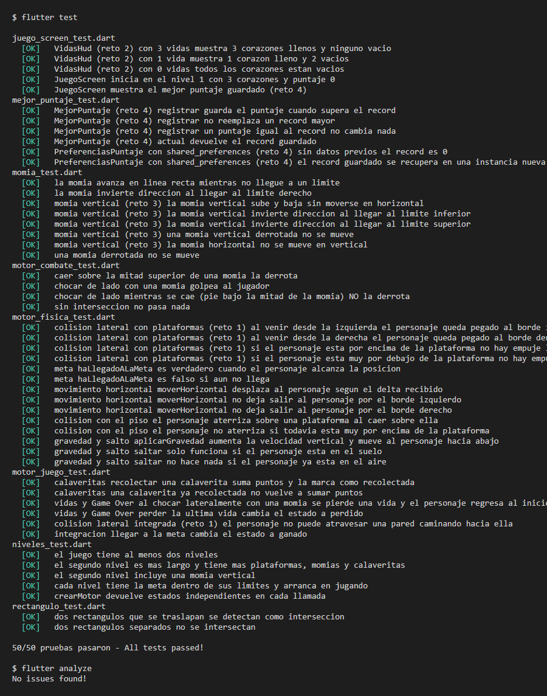
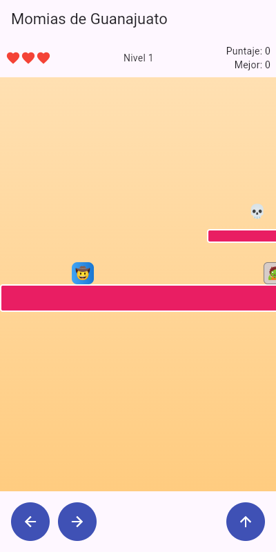
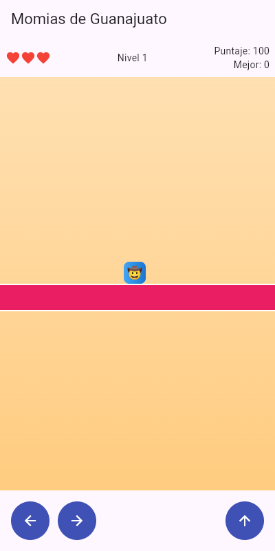
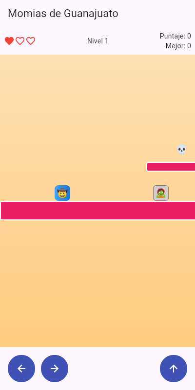
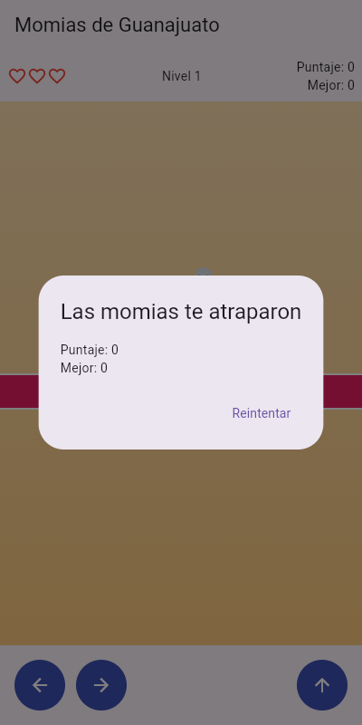
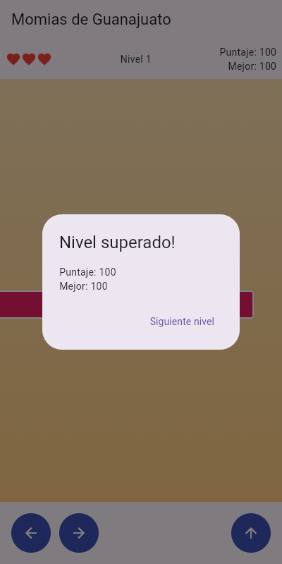
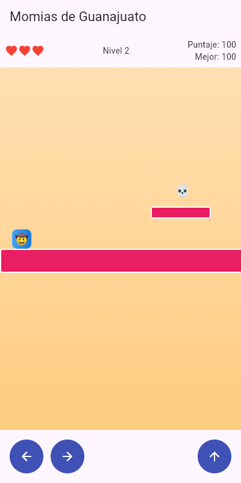
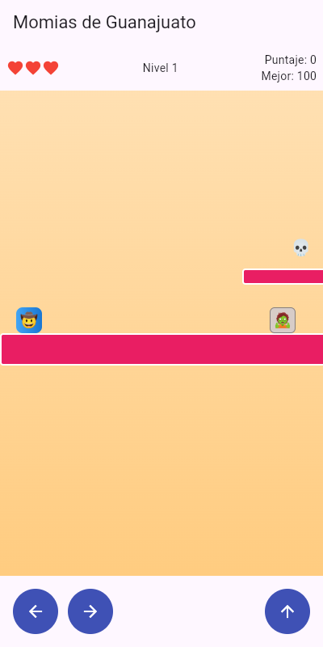
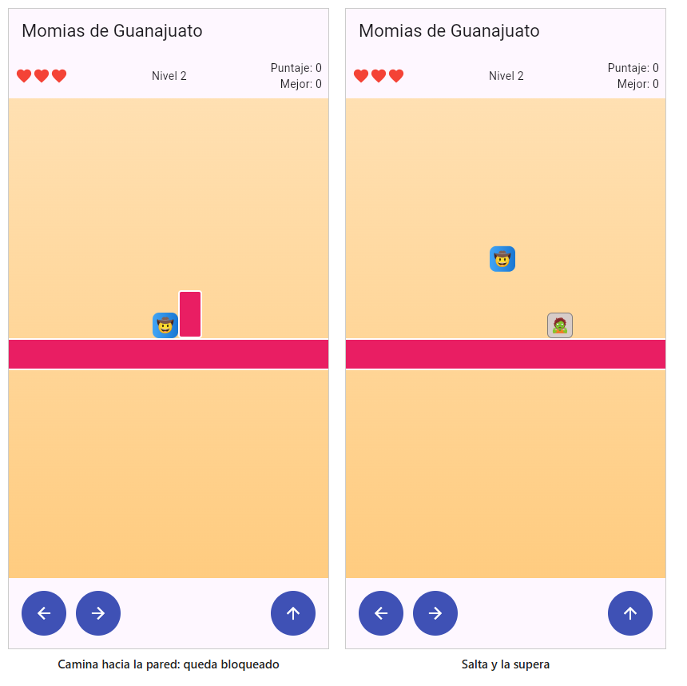
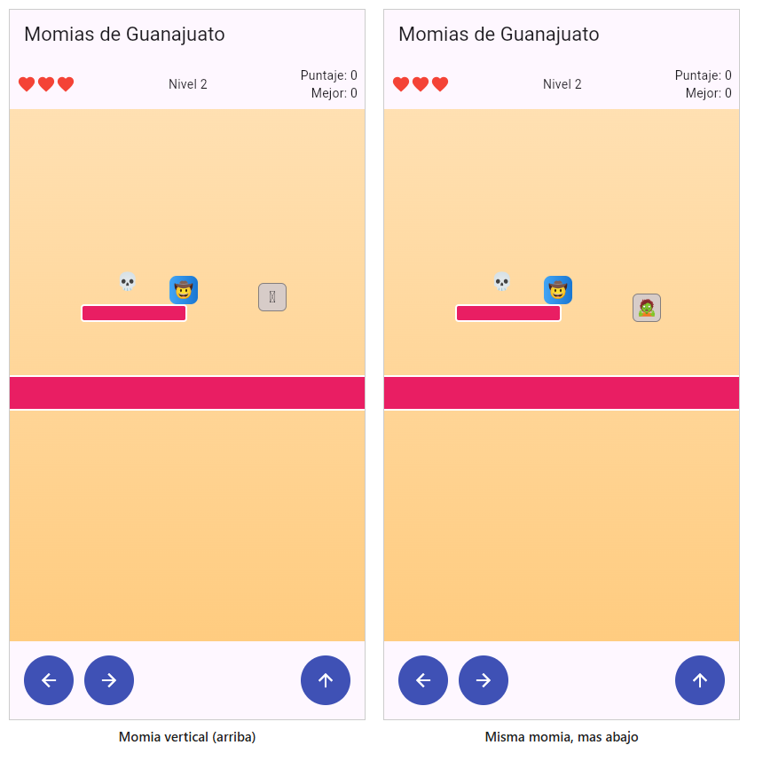

# Momias de Guanajuato: La Leyenda

Plataformas 2D con física real hecho en Flutter y construido **100 % con TDD**.
Proyecto complementario de práctica TDD — *Desarrollo Móvil Integral* (basado en `Manual_TDD_MomiasGuanajuato.docx`).

🤠 Salta · 🧟 Esquiva momias · 💀 Colecciona calaveritas · 💋 Llega al Callejón del Beso

**Estado:** 10 rondas del manual + los 5 retos de extensión implementados · 50 pruebas en verde · `flutter analyze` sin issues.

## Mecánicas

| Mecánica | Dónde vive | Prueba que la respalda |
|---|---|---|
| Gravedad y aterrizaje sobre plataformas | `MotorFisica.aplicarGravedad`, `resolverColisionConPiso` | `motor_fisica_test.dart` |
| Botones izquierda/derecha y salto | `MotorFisica.moverHorizontal`, `saltar` + `JuegoScreen` | `motor_fisica_test.dart` |
| Momias patrullan entre dos límites | `Momia.patrullar` | `momia_test.dart` |
| Saltar encima derrota a la momia; choque lateral quita una vida | `MotorCombate.resolverColision` | `motor_combate_test.dart` |
| Calaveritas suman 50 puntos (una sola vez) | `MotorJuego.recolectarSiCorresponde` | `motor_juego_test.dart` |
| Llegar a la meta gana; sin vidas pierde | `MotorJuego.mover` | `motor_juego_test.dart` |
| **Reto 1** — Las plataformas no se atraviesan por el costado | `MotorFisica.resolverColisionLateral` | `motor_fisica_test.dart`, `motor_juego_test.dart` |
| **Reto 2** — Vidas como corazones en el HUD | `presentation/vidas_hud.dart` | `juego_screen_test.dart` |
| **Reto 3** — Momia que sube y baja | `Momia.vertical` (misma clase `Momia`) | `momia_test.dart` |
| **Reto 4** — Mejor puntaje persistente | `MejorPuntaje` + `PreferenciasPuntaje` (`shared_preferences`) | `mejor_puntaje_test.dart` |
| **Reto 5** — Segundo nivel más largo | `logica/niveles.dart` (reusa el mismo `MotorJuego`) | `niveles_test.dart` |

## Estructura

```
lib/
  logica/                    (Dart puro, sin Flutter)
    rectangulo.dart          colisión AABB
    personaje.dart
    momia.dart               horizontal y vertical
    calaverita.dart
    motor_fisica.dart        gravedad, salto, piso, colisión lateral, límites, meta
    motor_combate.dart       stomp vs golpe
    estado_juego.dart
    motor_juego.dart         orquesta todo
    mejor_puntaje.dart       record + interfaz RepositorioPuntaje (costura)
    niveles.dart             nivel 1 y nivel 2
  datos/
    preferencias_puntaje.dart  RepositorioPuntaje con shared_preferences
  presentation/
    juego_screen.dart        cámara, sprites, controles, niveles, diálogos
    vidas_hud.dart           corazones
  main.dart
test/                        rectangulo, motor_fisica, momia, motor_combate,
                             motor_juego, mejor_puntaje, niveles, juego_screen
docs/
  capturas/                  evidencia gráfica
  evidencia_pruebas.txt      salida de flutter test / analyze
```

## Cómo ejecutar

```bash
flutter pub get
flutter test      # 50 pruebas en verde
flutter analyze   # sin issues
flutter run       # mantén presionadas ← → para caminar, ↑ para saltar
```

## Rondas TDD del manual (🔴 rojo → 🟢 verde)

| Ronda | Tema | Archivo de prueba |
|---|---|---|
| 1 | Colisión AABB | `rectangulo_test.dart` |
| 2 | Gravedad y salto | `motor_fisica_test.dart` |
| 3 | Aterrizar sobre una plataforma | `motor_fisica_test.dart` |
| 4 | Movimiento horizontal con límites | `motor_fisica_test.dart` |
| 5 | Patrullaje de la momia | `momia_test.dart` |
| 6 | Combate: stomp vs golpe | `motor_combate_test.dart` |
| 7 | Recolectar calaveritas | `motor_juego_test.dart` |
| 8 | Detectar la meta | `motor_fisica_test.dart` |
| 9 | Vidas y Game Over | `motor_juego_test.dart` |
| 10 | `MotorJuego` + prueba de integración | `motor_juego_test.dart` |

En cada ronda se escribió primero la prueba, se vio fallar y después se implementó el mínimo código para pasarla.

## Retos de extensión (sección 8 del manual)

Cada reto también se hizo con TDD: primero las pruebas (todas fallaron por no compilar), luego la implementación.

1. **Colisión lateral contra plataformas.** `resolverColisionLateral` usa la misma "costura testable" que el piso: recibe `xAnterior` para saber de qué lado venía el personaje y lo deja pegado al borde. Si solo roza por arriba o por abajo no empuja. `MotorJuego.mover()` la llama justo después del movimiento horizontal. El nivel 2 incluye una pared de 60 px que obliga a saltar.
2. **Corazones en el HUD.** `VidasHud` dibuja corazones llenos (vidas restantes) y vacíos (vidas perdidas). Reemplaza el texto "Vidas: N".
3. **Momia vertical.** Se reutiliza la clase `Momia` con `limiteArriba` / `limiteAbajo` y el constructor `Momia.vertical(...)`. `patrullar()` mueve en X solo si `velocidadX != 0` y en Y solo si `velocidadY != 0`, así que las momias horizontales no cambiaron.
4. **Mejor puntaje con `shared_preferences`.** `MejorPuntaje.registrar()` guarda solo si se supera el récord. La persistencia está detrás de la interfaz `RepositorioPuntaje`: las pruebas usan una versión en memoria y `PreferenciasPuntaje` se prueba con `SharedPreferences.setMockInitialValues`.
5. **Segundo nivel.** `Niveles.todos` define nivel 1 y nivel 2 (3000 px, 7 plataformas, 5 momias incluida una vertical, 6 calaveritas) con el mismo `MotorJuego`. Al ganar el nivel 1 aparece "Siguiente nivel" y el puntaje se acumula; al ganar el último, "Jugar de nuevo". Si pierdes, "Reintentar".

## Checklist del manual (sección 7)

- [x] La colisión AABB (`Rectangulo`) se probó de forma aislada antes de usarse en otra parte (Ronda 1).
- [x] `resolverColisionConPiso` usa la posición anterior del personaje (`yAnterior`), no solo la actual.
- [x] El criterio de *stomp* exige caer **y** tener el pie en la mitad superior de la momia; hay una prueba explícita del choque lateral cayendo.
- [x] La lógica sensible al tiempo es determinista: `patrullar()` no usa aleatoriedad ni reloj; el bucle de 16 ms vive solo en la interfaz.
- [x] `MotorJuego.mover()` es el único lugar que decide el orden: movimiento → colisión lateral → gravedad → piso → momias/combate → calaveritas → meta.
- [x] La interfaz no decide colisiones ni puntajes: solo traduce el estado de `MotorJuego` a píxeles.

## Evidencia

Las capturas de juego se tomaron ejecutando este código compilado para web (`flutter build web`) en Chrome con viewport de móvil (400×800), controlado por un script que mantiene presionado → y salta. Los diálogos son los reales de la app.

### Pruebas y análisis estático



Texto completo en [`docs/evidencia_pruebas.txt`](docs/evidencia_pruebas.txt).

### Juego base

| Inicio del nivel 1 (3 corazones) | Calaveritas recolectadas (100 pts) |
|---|---|
|  |  |

| Golpe de momia: 1 corazón y reinicio | Game Over |
|---|---|
|  |  |

### Reto 2 (corazones), reto 4 (récord) y reto 5 (niveles)

| Nivel 1 superado | Nivel 2 con puntaje acumulado |
|---|---|
|  |  |

Récord persistido: tras recargar la página, nuevo juego con puntaje 0 y **Mejor: 100**.



### Reto 1: colisión lateral



### Reto 3: momia vertical



> Las capturas de la pared y de la momia vertical, que están al final del nivel 2, se tomaron con una copia temporal de la app cuyo único cambio es poder fijar la posición inicial por URL (`?n=2&x=1650`). La lógica es la misma del repositorio.

## Correcciones al manual

Al ejecutar el código del manual aparecieron problemas, resueltos así:

1. **Ronda 3:** la prueba de aterrizaje (`y=90`, `yAnterior=85`) nunca puede pasar porque el pie ya está debajo de la plataforma. Se usó `y=70`, `yAnterior=65`.
2. **Ronda 6:** con `y=68` el borde inferior del personaje toca exactamente `y=100` y el AABB estricto no lo cuenta como intersección. Se usó `y=72`.
3. **Pantalla:** `calaveritas: const [...]` no compila porque `Calaverita` tiene campos mutables; se quitó el `const`.
4. **Pruebas:** los fragmentos del manual omiten imports; se escribieron archivos completos y se sustituyó el `widget_test.dart` del contador por pruebas de la pantalla.
5. **Diálogo de resultado:** el manual lo deja cerrable con un toque fuera, lo que dejaba el juego detenido sin salida. Ahora `barrierDismissible: false`: solo se cierra con su botón.
