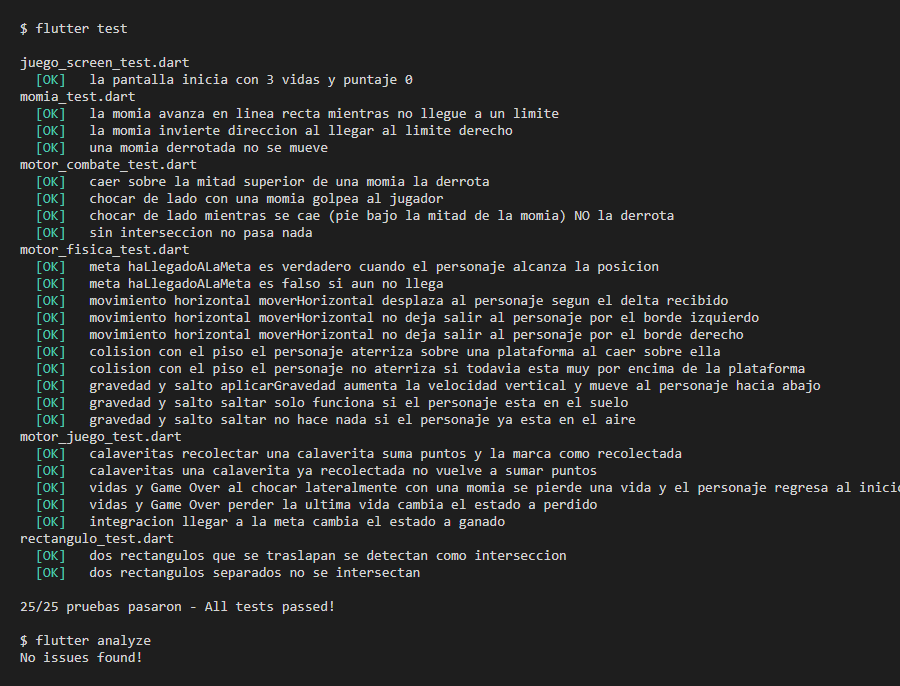
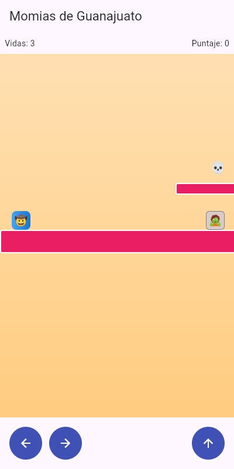
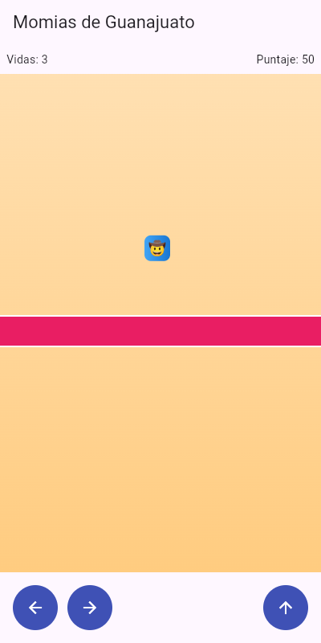
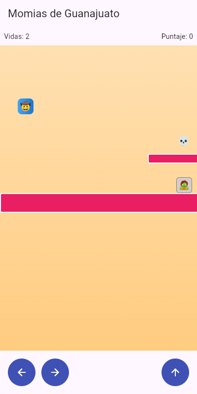
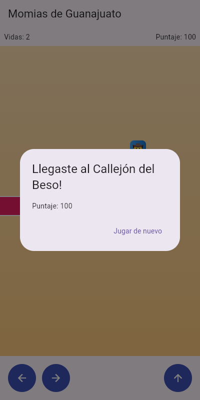
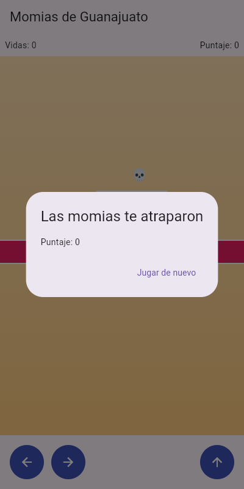

# Momias de Guanajuato: La Leyenda

Plataformas 2D con física real hecho en Flutter y construido **100 % con TDD**.
Proyecto complementario de práctica TDD — *Desarrollo Móvil Integral* (basado en `Manual_TDD_MomiasGuanajuato.docx`).

🤠 Salta · 🧟 Esquiva momias · 💀 Colecciona calaveritas · 💋 Llega al Callejón del Beso

## Mecánicas

| Mecánica del manual | Dónde vive | Prueba que la respalda |
|---|---|---|
| Gravedad y aterrizaje sobre plataformas | `MotorFisica.aplicarGravedad`, `resolverColisionConPiso` | `motor_fisica_test.dart` |
| Botones izquierda/derecha y salto | `MotorFisica.moverHorizontal`, `saltar` + `JuegoScreen` | `motor_fisica_test.dart` |
| Momias patrullan entre dos límites e invierten dirección | `Momia.patrullar` | `momia_test.dart` |
| Saltar encima derrota a la momia; choque lateral quita una vida | `MotorCombate.resolverColision` | `motor_combate_test.dart` |
| Calaveritas suman 50 puntos (una sola vez) | `MotorJuego.recolectarSiCorresponde` | `motor_juego_test.dart` |
| Llegar a la meta gana; sin vidas pierde | `MotorJuego.mover`, `MotorFisica.haLlegadoALaMeta` | `motor_juego_test.dart`, `motor_fisica_test.dart` |

## Estructura

```
lib/
  logica/                  (Dart puro, sin Flutter)
    rectangulo.dart        colisión AABB
    personaje.dart
    momia.dart
    calaverita.dart
    motor_fisica.dart      gravedad, salto, aterrizaje, límites, meta
    motor_combate.dart     stomp vs golpe
    estado_juego.dart
    motor_juego.dart       orquesta todo
  presentation/
    juego_screen.dart      cámara, sprites, controles
  main.dart
test/
  rectangulo_test.dart  motor_fisica_test.dart  momia_test.dart
  motor_combate_test.dart  motor_juego_test.dart  juego_screen_test.dart
docs/
  capturas/                evidencia gráfica
  evidencia_pruebas.txt    salida de flutter test / analyze
```

## Cómo ejecutar

```bash
flutter pub get
flutter test      # 25 pruebas en verde
flutter analyze   # sin issues
flutter run       # mantén presionadas ← → para caminar, ↑ para saltar
```

## Rondas TDD realizadas (🔴 rojo → 🟢 verde)

| Ronda | Tema | Archivo de prueba |
|---|---|---|
| 1 | Colisión AABB | `rectangulo_test.dart` |
| 2 | Gravedad y salto | `motor_fisica_test.dart` |
| 3 | Aterrizar sobre una plataforma | `motor_fisica_test.dart` |
| 4 | Movimiento horizontal con límites | `motor_fisica_test.dart` |
| 5 | Patrullaje de la momia | `momia_test.dart` |
| 6 | Combate: stomp vs golpe | `motor_combate_test.dart` |
| 7 | Recolectar calaveritas | `motor_juego_test.dart` |
| 8 | Detectar la meta | `motor_fisica_test.dart` |
| 9 | Vidas y Game Over | `motor_juego_test.dart` |
| 10 | `MotorJuego` + prueba de integración | `motor_juego_test.dart` |

En cada ronda se escribió primero la prueba, se vio fallar y después se implementó el mínimo código para pasarla.

## Checklist del manual (sección 7)

- [x] La colisión AABB (`Rectangulo`) se probó de forma aislada antes de usarse en otra parte (`rectangulo_test.dart`, Ronda 1).
- [x] `resolverColisionConPiso` usa la posición anterior del personaje (`yAnterior`), no solo la actual.
- [x] El criterio de *stomp* exige caer **y** tener el pie en la mitad superior de la momia. Se cubre con una prueba explícita: caer pero chocar de lado **no** derrota a la momia.
- [x] La lógica sensible al tiempo es determinista: `patrullar()` no usa aleatoriedad ni reloj; el bucle de 16 ms vive solo en la interfaz.
- [x] `MotorJuego.mover()` es el único lugar que decide el orden: física → piso → momias/combate → calaveritas → meta.
- [x] La interfaz no decide colisiones ni puntajes: `juego_screen.dart` solo traduce el estado de `MotorJuego` a píxeles.

## Evidencia

### Pruebas y análisis estático



Texto completo en [`docs/evidencia_pruebas.txt`](docs/evidencia_pruebas.txt).

### Juego en ejecución

| Inicio (3 vidas, 0 puntos) | Calaverita recolectada (+50) |
|---|---|
|  |  |

| Golpe de momia: −1 vida y reinicio | Victoria en el Callejón del Beso |
|---|---|
|  |  |

| Game Over (0 vidas) |
|---|
|  |

> Las capturas de juego se tomaron ejecutando este mismo código compilado para web (`flutter build web`) en Chrome con un viewport de móvil (400×800), controlado por un script que mantiene presionado → y salta. Los diálogos de victoria y derrota son los reales de la app.

## Correcciones al manual

Al ejecutar el código del manual aparecieron cuatro problemas, resueltos así:

1. **Ronda 3:** la prueba de aterrizaje (`y=90`, `yAnterior=85`) nunca puede pasar, porque el pie ya está debajo de la plataforma. Se usó `y=70`, `yAnterior=65`.
2. **Ronda 6:** con `y=68` el borde inferior del personaje toca exactamente `y=100` y el AABB estricto no lo cuenta como intersección. Se usó `y=72`.
3. **Pantalla:** `calaveritas: const [...]` no compila porque `Calaverita` tiene campos mutables; se quitó el `const`.
4. **Pruebas:** los fragmentos del manual omiten imports; se escribieron archivos completos. Además se eliminó el `widget_test.dart` del contador que genera `flutter create` y se reemplazó por `juego_screen_test.dart`.

## Retos de extensión (opcionales, no implementados)

Colisión lateral contra plataformas · corazones en el HUD · momia con patrullaje vertical · mejor puntaje con `shared_preferences` · segundo nivel.
